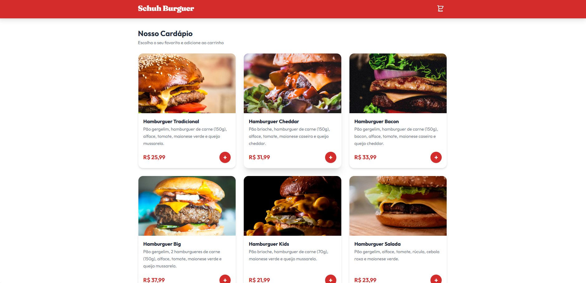
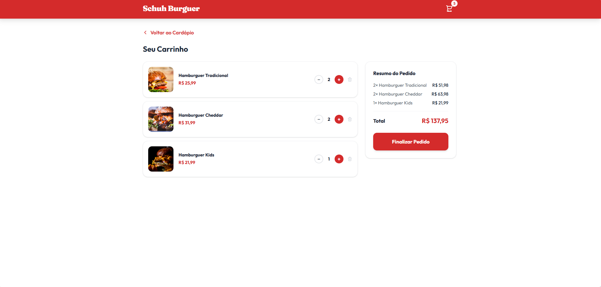
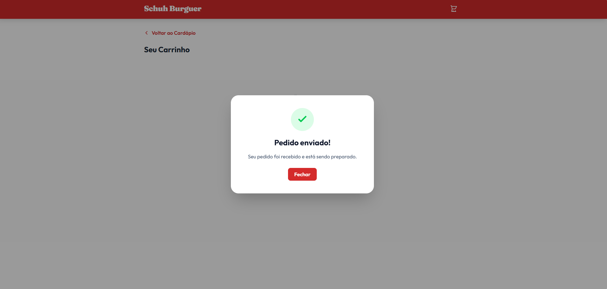

# Schuh Burguer

Aplicação web **full stack** de cardápio e pedidos para uma hamburgueria. O cliente escolhe os hambúrgueres, monta o carrinho e finaliza o pedido, que é validado pela API e gravado em um banco PostgreSQL.

A interface é baseada em um protótipo feito no Figma. O projeto cobre o caminho completo de um dado: **banco de dados → API → interface** e a volta.

## Telas

| Cardápio | Carrinho | Pedido enviado |
|---|---|---|
|  |  |  |

## Funcionalidades

- Cardápio carregado do banco de dados, com foto, descrição e preço de cada item
- Carrinho com adição, aumento e redução de quantidade, remoção de itens e total em tempo real
- Contador de itens no cabeçalho
- Finalização do pedido: a API valida os dados e grava o pedido e seus itens no PostgreSQL
- Confirmação em modal ("Pedido enviado!")
- Tela de carrinho vazio e avisos de erro quando a API recusa o pedido ou está fora do ar
- Layout responsivo, com acessibilidade básica (rótulos para leitores de tela, foco no modal)

## Tecnologias

| Camada | Tecnologias |
|---|---|
| Front-end | React, Vite, JavaScript, Tailwind CSS 4 |
| Back-end | C#, ASP.NET Core Web API (.NET 10), Entity Framework Core |
| Banco de dados | PostgreSQL (driver Npgsql) |

## Como funciona

Fluxo de "Finalizar Pedido":

```
React (carrinho)
  │  POST /api/pedidos
  │  { "itens": [ { "produtoId": 1, "quantidade": 2 } ] }
  ▼
PedidosController ── recebe a requisição e traduz o resultado em HTTP (201 ou 400)
  │
  ▼
PedidoService ── aplica as regras: valida, busca o preço e monta o pedido
  │
  ▼
PedidoRepository ── busca os produtos e grava Pedido + ItensPedido (Entity Framework Core)
  │
  ▼
PostgreSQL
  │
  ▼
201 Created { "id": 1 }  ──►  React limpa o carrinho e mostra o modal
```

### Decisões de projeto

- **O preço nunca vem do cliente.** O navegador envia apenas `produtoId` e `quantidade`. A API busca o preço no banco, o que impede alguém de alterar a requisição para pagar menos.
- **O preço fica registrado no item do pedido** (`PrecoUnitario`). Se o preço de um produto mudar depois, os pedidos antigos continuam com o valor da época.
- **Validação antes de gravar.** Lista vazia, quantidade menor ou igual a zero e produto inexistente retornam `400` sem gravar nada. O pedido e todos os seus itens são salvos juntos, numa única operação.
- **O total não é guardado no banco.** Ele é calculado somando `quantidade × preço` dos itens.
- **O carrinho vive no front-end** (estado do React). Sem login nesta versão, ele só vira dado persistente quando se torna um pedido.
- **Regras de negócio fora do controller.** O `PedidoService` valida e monta o pedido sem conhecer HTTP: quando algo é inválido, lança uma `PedidoInvalidoException`, e o controller a traduz em `400` com a mensagem do erro. O `PedidoService` depende da interface `IPedidoRepository`, e não do banco, o que permite testá-lo com um repositório falso.
- **Segredos fora do repositório.** A senha do banco fica nos *user-secrets* do .NET, e não no código.

### Modelo de dados

```
Produtos 1 ───< ItensPedido >─── 1 Pedidos
```

| Tabela | Campos |
|---|---|
| `Produtos` | Id, Nome, Descricao, Preco, ImagemUrl |
| `Pedidos` | Id, CriadoEm |
| `ItensPedido` | Id, PedidoId, ProdutoId, Quantidade, PrecoUnitario |

## API

| Método | Rota | Descrição | Respostas |
|---|---|---|---|
| `GET` | `/api/produtos` | Lista o cardápio | `200` |
| `POST` | `/api/pedidos` | Cria um pedido | `201` com `{ "id": ... }`, `400` |

Exemplo de requisição:

```json
{
  "itens": [
    { "produtoId": 1, "quantidade": 2 },
    { "produtoId": 3, "quantidade": 1 }
  ]
}
```

## Como rodar localmente

### Pré-requisitos

- [.NET SDK 10](https://dotnet.microsoft.com/download)
- [Node.js](https://nodejs.org/) (versão LTS recente)
- [PostgreSQL](https://www.postgresql.org/download/)

Clone este repositório e, na raiz do projeto, siga os passos abaixo.

### 1. Back-end

```bash
cd backend/Restaurante.Api

# Guarda a connection string fora do repositório (troque SUA_SENHA)
dotnet user-secrets set "ConnectionStrings:RestauranteDb" "Host=localhost;Database=restaurante_db;Username=postgres;Password=SUA_SENHA"

# Cria o banco e as tabelas (instale a ferramenta uma vez: dotnet tool install --global dotnet-ef)
dotnet ef database update

# Sobe a API em http://localhost:5251
dotnet run
```

### 2. Dados de exemplo

Com o banco criado, execute o arquivo [`database/seed.sql`](database/seed.sql) no pgAdmin ou pelo terminal:

```bash
psql -U postgres -d restaurante_db -f database/seed.sql
```

O script só insere os produtos se a tabela estiver vazia, então é seguro rodá-lo mais de uma vez.

### 3. Front-end

```bash
cd frontend
npm install
npm run dev
```

Acesse **http://localhost:5173**.

## Estrutura do projeto

```
.
├── backend/Restaurante.Api/
│   ├── Controllers/   # ProdutosController, PedidosController
│   ├── Services/      # PedidoService (regras de negócio do pedido)
│   ├── Repositories/  # IPedidoRepository, PedidoRepository (acesso ao banco)
│   ├── Exceptions/    # PedidoInvalidoException
│   ├── Data/          # RestauranteDbContext
│   ├── Domain/        # Produto, Pedido, ItemPedido
│   ├── Dtos/          # PedidoCriarDto, ItemPedidoDto
│   ├── Migrations/    # histórico do banco (EF Core)
│   └── Program.cs     # configuração da API, CORS e conexão com o banco
├── frontend/
│   └── src/
│       ├── components/  # ProdutoCard, ItemCarrinho, Header, ResumoPedido,
│       │                # ModalPedidoEnviado, AvisoErro
│       ├── pages/       # Cardapio, Carrinho
│       ├── utils/       # formatarMoeda
│       └── App.jsx      # estado da aplicação, chamadas à API e composição das telas
├── database/seed.sql  # dados de exemplo
└── docs/img/          # imagens usadas neste README
```

## Próximos passos

- Consultar um pedido por id (`GET /api/pedidos/{id}`) e uma tela de confirmação própria
- Levar o cardápio (`ProdutosController`) para Service e Repository; hoje só o fluxo de pedidos está em camadas
- Testes automatizados no back-end (unitários do `PedidoService`)
- Mover a URL da API no front-end para uma variável de ambiente
- Categorias no cardápio, autenticação e painel para cadastrar produtos
- Docker e publicação online
